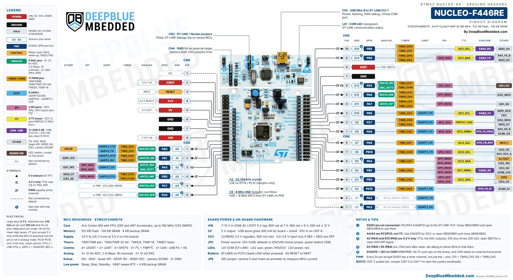

# STM32 Embedded Software Library

## Overview

This repository contains a collection of reusable embedded software components and low-level drivers for STM32 microcontrollers.

The main objective is to develop, implement, and organize hardware-independent and hardware-dependent software layers to facilitate peripheral management and communication with external devices.

The project focuses on modularity, maintainability, portability, and code reusability across STM32-based embedded applications.

## Target Platform

| Parameter | Description |
|---|---|
| Microcontroller | STM32F446RE |
| Development Board | NUCLEO-F446RE |
| Core | ARM Cortex-M4 |
| Programming Language | C |
| Development Environment | STM32CubeIDE |
| Hardware Interface | CMSIS / STM32 HAL (depending on implementation) |

## Project Architecture

```text
F446-Drivers/
│
├── Drivers/
│   └── CMSIS/
│
├── Inc/
│   └── Application headers
│
├── Src/
│   └── Application source files
│
└── Library/
    │
    ├── components/
    │   └── ...
    │
    ├── protocols/
    │   ├── one-wire/
    │   ├── spi/
    │   └── i2c/
    │
    └── low_level/
        └── stm32/
            └── ...
```

## Library Organization

The software library is divided into three main layers.

### 1. Components (`Library/components/`)

Contains reusable software components and functional modules designed to interface with specific external devices or provide higher-level functionalities.

These components rely on the communication protocols and low-level drivers implemented in the underlying layers.

### 2. Communication Protocols (`Library/protocols/`)

Contains implementations of communication protocols used to interface with external devices and peripherals.

Current protocol implementations include:

- **One-Wire:** Communication protocol implementation for One-Wire devices.
- **I2C:** Inter-Integrated Circuit communication.
- **SPI:** Serial Peripheral Interface communication.

Each protocol is designed to provide a reusable interface between hardware-specific drivers and higher-level components.

### 3. Low-Level Drivers (`Library/low_level/`)

Contains hardware-dependent functions responsible for direct interaction with the microcontroller peripherals.

- **STM32 (`stm32/`):** STM32-specific implementations, including GPIO management, peripheral access, and hardware-level operations.

This layer provides the hardware abstraction required by the communication protocols.

## External Dependencies and References

Some files included in this repository, particularly within the `Drivers/` directory, are based on or reused from the following project:

**STM32F446_FromScratch – Sylvain Montagny**

Repository: https://github.com/SylvainMontagny/STM32F446_FromScratch

This project provides STM32F446RE-related resources, including CMSIS drivers and supporting project files.

The original repository is acknowledged as a source for the reused files. The implementations developed specifically for this repository are organized separately under `Library/`.

Please refer to the original repository for its source files and licensing information.

## Development Goals

The project aims to:

- Develop reliable and reusable low-level drivers.
- Implement communication protocols such as I2C, SPI, and One-Wire.
- Separate hardware-dependent code from communication protocol implementations.
- Create reusable components for external devices.
- Improve software modularity and maintainability.
- Facilitate the integration of embedded components into future STM32 projects.

## Hardware Reference – NUCLEO-F446RE

The following pinout diagram provides a hardware reference for the STM32 NUCLEO-F446RE development board.

It can be used to identify GPIO pins, alternate functions, communication interfaces, timers, and peripheral mappings during hardware development.



*Pinout diagram: DeepBlueMbedded.*

## Project Status

This project is currently under development.

New low-level drivers, communication protocols, and reusable components will be progressively implemented, tested, and integrated into the library.

Some implementations may still require additional hardware validation.

---

*Embedded software development – STM32F446RE platform.*
